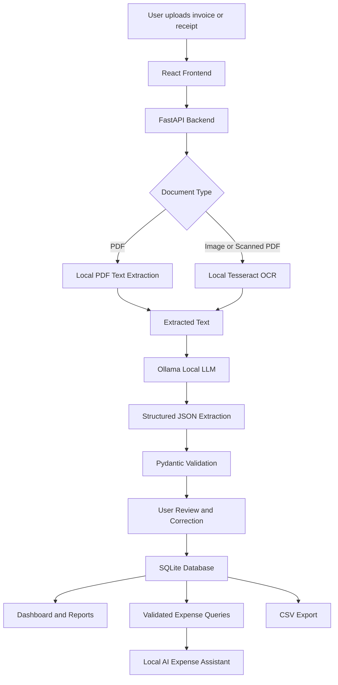

# InvoiceMate AI 💸

### Your invoices. Your data. Your AI. Your machine.

InvoiceMate AI is a privacy-first, local-first AI assistant that helps freelancers, independent developers, consultants, and small business owners manage invoices, organize receipts, track expenses, and generate financial summaries without relying on paid AI APIs.

Built around open-weight AI and local inference, InvoiceMate AI makes document processing more private, customizable, and cost-predictable.

> **No paid AI API keys. No expiring inference credits. No mandatory cloud processing. Just AI running locally on your machine.**

*This project is a submission for the Hacktoberfest Open-Source AI Challenge — Week 2: Side Hustle.*

## What I Built

Freelancers and small business owners deal with invoices, receipts, expense tracking, and repetitive financial administration every day.

Existing AI-powered tools may require subscriptions, usage-based API billing, or uploading sensitive documents to third-party services.

InvoiceMate AI takes a different approach.

It uses locally executed OCR, an open-weight language model, and a local database to turn documents into structured, searchable financial records.

### Key Features

- **Smart Document Processing:** Upload PDF invoices and image-based receipts.
- **Local AI Extraction:** Extract vendor names, dates, invoice numbers, totals, taxes, and expense categories.
- **Review Before Saving:** Inspect and correct extracted information before storing it.
- **Expense Dashboard:** View spending trends, category breakdowns, and recent invoices.
- **AI Expense Assistant:** Ask questions about your locally stored financial records.
- **Smart Search and Filters:** Find documents by vendor, date, category, amount, or payment status.
- **CSV Export:** Export records and expense summaries for further analysis.
- **Privacy First:** Keep documents and financial records on your own machine.
- **Offline-First:** Continue using core features without internet access after the initial setup.
- **Model Flexibility:** Switch between compatible local models without depending on a single AI provider.

## The Problem

Managing invoices manually is repetitive, time-consuming, and error-prone.

Small businesses and freelancers often have to:

- Open every invoice individually.
- Manually copy amounts, dates, and vendor details.
- Organize receipts into folders.
- Calculate expenses across different categories.
- Track invoice due dates and payment status.
- Pay for cloud AI tools just to automate routine tasks.

InvoiceMate AI aims to simplify this workflow while keeping financial information under the user's control.

## The Solution

InvoiceMate AI combines local OCR, open-weight language models, deterministic calculations, and a lightweight local database.

The workflow is straightforward:

1. Upload an invoice or receipt.
2. Extract text locally using OCR or PDF parsing.
3. Process the extracted text using a locally running AI model.
4. Validate and review the structured information.
5. Save the verified record in SQLite.
6. Search, analyze, and export your financial data.

The AI assists with extraction and natural-language understanding. Financial totals and database queries are handled by deterministic application logic wherever possible.

---

## How It Uses Open-Source AI

Open innovation is not just an additional feature in InvoiceMate AI. It is central to the product's architecture.

| Component | Technology | Purpose |
|---|---|---|
| Local language model | Ollama + compatible open-weight model | Extract structured information and interpret questions |
| OCR | Tesseract OCR | Read text from scanned invoices and receipts |
| PDF processing | Local PDF parsing libraries | Extract embedded document text |
| Backend | Python + FastAPI | Process documents and serve application APIs |
| Database | SQLite | Store financial records locally |
| Frontend | React + TypeScript | Provide an interactive dashboard |
| Visualization | Recharts | Display expense summaries and trends |

The selected model must support local execution through the configured Ollama installation. Model availability, license terms, hardware requirements, and capabilities may vary.

### Why local inference?

**1. No expiring AI API credits**

The application does not depend on a paid inference API. Once the model is downloaded, inference runs locally without per-request cloud AI charges.

**2. Better privacy by design**

Invoices and receipts can contain names, addresses, financial details, and business information. Local processing avoids sending these documents to a third-party inference provider.

**3. No mandatory internet connection**

After dependencies and model weights are installed, the main document-processing workflow can operate offline.

**4. Freedom to experiment**

Developers can replace compatible models, adjust prompts, change extraction logic, and customize the system for different business needs.

**5. Predictable operating costs**

There are no mandatory per-token inference charges. Hardware, electricity, storage, and maintenance costs still apply.

---

## Architecture

All document processing and AI inference are designed to run on the user's machine. No cloud inference fallback is required.

## Privacy and Security

InvoiceMate AI is designed to keep sensitive financial information under the user's control.

- Document extraction runs locally.
- AI inference runs through a local model.
- Financial records are stored in a local SQLite database.
- No cloud inference fallback should occur.
- Users can export or delete their records.
- Uploaded documents should be validated before processing.
- Sensitive information should not be written to application logs.

**Important:** Local processing does not automatically guarantee complete security. Anyone with sufficient access to an unprotected computer or its files may be able to access locally stored information. Use appropriate operating-system permissions, device encryption, and backups.

---

## Running Without Internet

The application is designed for offline use after initial installation.

Before disconnecting from the internet:

1. Install all application dependencies.
2. Download the selected Ollama model.
3. Verify OCR and PDF processing.
4. Start the backend and frontend.
5. Upload and process a test document.
6. Verify that records persist after restarting the application.

Once setup is complete, the core workflow should not require an external AI service.

The first installation, model download, dependency installation, and software updates may require internet access.

---

## Who Is This For?

### Freelancers

Organize client-related invoices and review expenses without uploading sensitive records to a cloud AI service.

### Independent Developers

Automate repetitive financial administration while keeping the tool customizable.

### Consultants

Search receipts and summarize recorded expenses locally.

### Small Business Owners

Reduce manual document entry and maintain a searchable invoice library.

### Privacy-Conscious Users

Run an AI-powered document workflow without depending on a remote inference provider.

---

## Side Hustle Potential

InvoiceMate AI follows an open-core-friendly approach: the core application can remain open source while paid services provide additional value.

Potential revenue streams include:

- Local installation and configuration services.
- Business-specific document extraction customization.
- Custom report templates and workflows.
- On-premises deployment and integration.
- Training, maintenance, and technical support.

The core tool is intended to remain accessible. Revenue would come from convenience, customization, and support rather than mandatory AI inference subscriptions.

These are proposed business opportunities, not claims of existing paying customers or validated market demand.

## Contributing

Contributions are welcome!

You can contribute by:

- Improving OCR accuracy.
- Adding document formats.
- Improving extraction validation.
- Supporting additional compatible local models.
- Improving the interface and accessibility.
- Adding tests and documentation.
- Reporting bugs and suggesting features.

### Contribution Workflow

1. Fork the repository.
2. Create a feature branch.
3. Make your changes.
4. Run relevant tests.
5. Submit a pull request with a clear description.

Please do not submit real financial documents, secrets, or personal information in issues, tests, screenshots, or pull requests.

See `CONTRIBUTING.md` for contribution guidelines.

---

## 🏆 Hacktoberfest Open-Source AI Challenge

**Challenge:** Week 2 — Side Hustle

**Theme:** Build something with open-weight models or open-source AI that someone would actually pay for.

InvoiceMate AI explores how open-weight AI and local inference can help freelancers and small businesses automate invoice processing without mandatory cloud inference costs.

The project emphasizes practical utility, privacy, model flexibility, and transparent operating costs.

